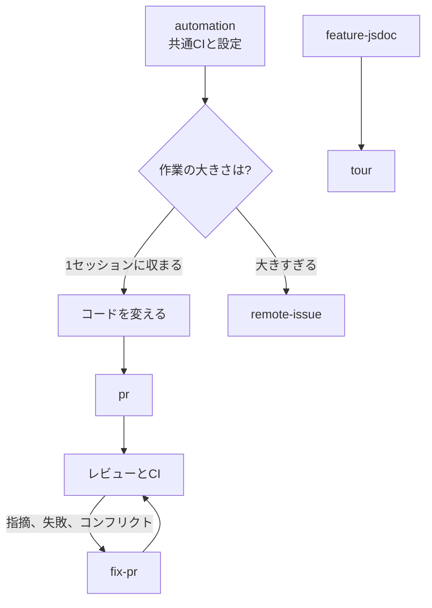

# code

ソフトウェアリポジトリで作業するためのスキル。言語は問わない。アプリが何をするかの記述、共通CI、IssueとPull Requestでの作業の進め方。
`skill-kit code sync` のあと `init` を実行して使い始める。

## 流れ

## 1. リポジトリの準備

| スキル | すること |
|---|---|
| [init](../../shared/skills/init/README.ja.md) | リポジトリをmiseとmakeに載せ、すべてのコマンドを `make <name>` で動かす |
| [task](../../shared/skills/task/README.ja.md) | `make <name>` のコマンドを追加・変更する |
| [automation](../../shared/skills/automation/README.ja.md) | 組織の共通GitHub Actionsと設定を入れる |

## 2. アプリを知る

| スキル | すること |
|---|---|
| [feature-jsdoc](skills/feature-jsdoc/README.ja.md) | ページとコンポーネントに、ユーザーから見た `@feature` JSDocを付ける・直す |
| [tour](skills/tour/README.ja.md) | そのJSDocをもとに、新メンバーに機能グループごとにアプリを案内する |

## 3. 作業をマージまで運ぶ

| スキル | すること |
|---|---|
| [cap](../../shared/skills/cap/README.ja.md) | すべてをコミットして今のブランチにpushする |
| [pr](../../shared/skills/pr/README.ja.md) | Pull Requestを作る。ブランチにすでにあれば更新する |
| [fix-pr](../../shared/skills/fix-pr/README.ja.md) | レビューの指摘、CIの失敗、コンフリクトを直し、指摘ごとに返信する |
| [remote-issue](../../shared/skills/remote-issue/README.ja.md) | 1セッションに収まらない作業を、Issueワーカーが並行して実装するIssueに分ける |
