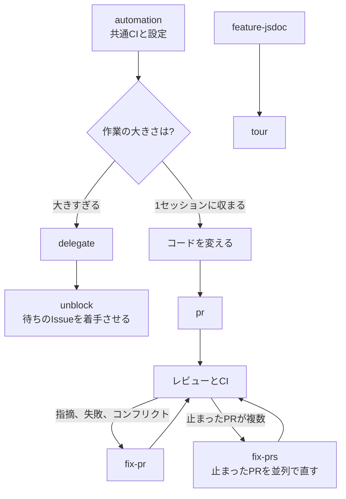

# code

ソフトウェアリポジトリで作業するためのスキル。言語は問わない。アプリが何をするかの記述、共通CI、IssueとPull Requestでの作業の進め方。
`skill-kit code sync` のあと `init` を実行して使い始める。

## 流れ

## 1. リポジトリの準備

- [init](../../shared/skills/init/README.ja.md)
- [task](../../shared/skills/task/README.ja.md)
- [automation](../../shared/skills/automation/README.ja.md)

## 2. アプリを知る

- [feature-jsdoc](skills/feature-jsdoc/README.ja.md)
- [tour](skills/tour/README.ja.md)

## 3. 作業をマージまで運ぶ

- [cap](../../shared/skills/cap/README.ja.md)
- [pr](../../shared/skills/pr/README.ja.md)
- [fix-pr](../../shared/skills/fix-pr/README.ja.md)
- [fix-prs](../../shared/skills/fix-prs/README.ja.md)
- [delegate](../../shared/skills/delegate/README.ja.md)
- [unblock](../../shared/skills/unblock/README.ja.md)
