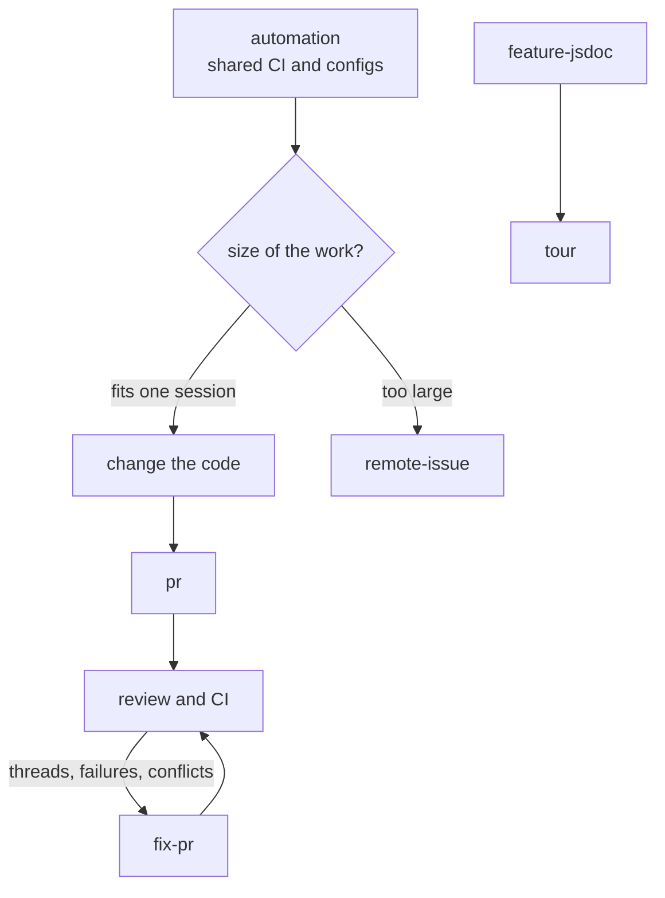

# code

Skills for working in a software repo, in any language: documenting what an app does,
shared CI, and getting work through issues and pull requests.
Set a repo up with `skill-kit code sync`, then run `init`.

## Flow

## 1. Repo setup

| Skill | What it does |
|---|---|
| [init](../../shared/skills/init/README.md) | Puts the repo on mise and make, so every command runs as `make <name>` |
| [task](../../shared/skills/task/README.md) | Adds or changes a `make <name>` command |
| [automation](../../shared/skills/automation/README.md) | Sets up the org's shared GitHub Actions and configs |

## 2. Knowing the app

| Skill | What it does |
|---|---|
| [feature-jsdoc](skills/feature-jsdoc/README.md) | Adds or revises `@feature` JSDoc on pages and components, from the user's point of view |
| [tour](skills/tour/README.md) | Walks a new member through the app, feature group by feature group, from that JSDoc |

## 3. Getting work merged

| Skill | What it does |
|---|---|
| [cap](../../shared/skills/cap/README.md) | Commits everything and pushes to the current branch |
| [pr](../../shared/skills/pr/README.md) | Opens a pull request, or updates the one the branch has |
| [fix-pr](../../shared/skills/fix-pr/README.md) | Fixes review threads, failing CI and conflicts, then answers each thread |
| [remote-issue](../../shared/skills/remote-issue/README.md) | Splits work too large for one session into issues the issue worker implements in parallel |
