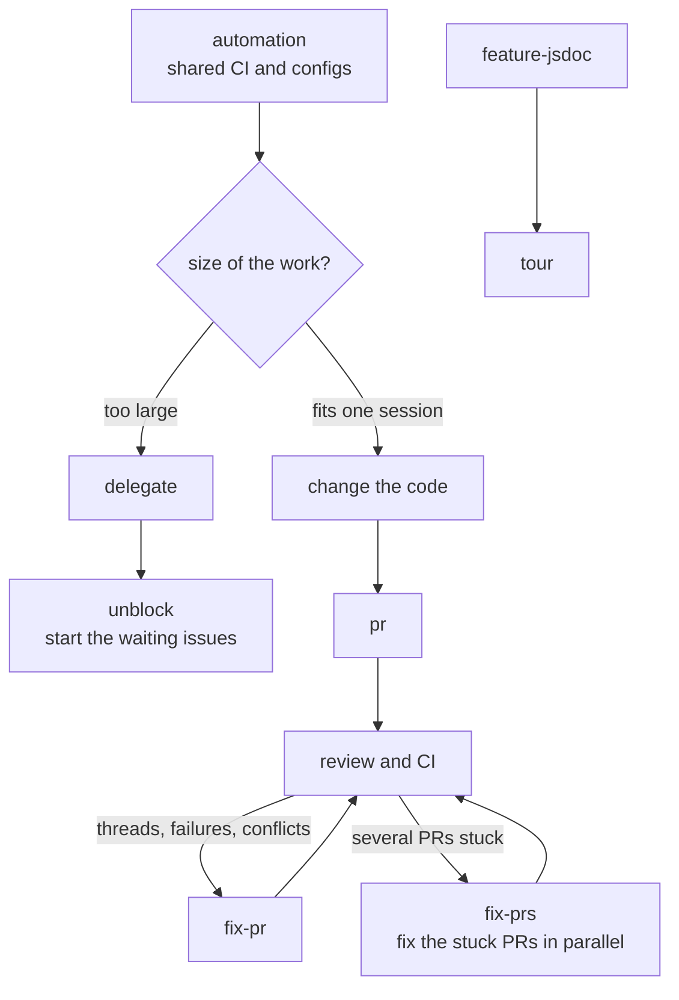

# code

Skills for working in a software repo, in any language: documenting what an app does,
shared CI, and getting work through issues and pull requests.
Set a repo up with `skill-kit code sync`, then run `init`.

## Flow

## 1. Repo setup

- [init](../../shared/skills/init/README.md)
- [task](../../shared/skills/task/README.md)
- [automation](../../shared/skills/automation/README.md)

## 2. Knowing the app

- [feature-jsdoc](skills/feature-jsdoc/README.md)
- [tour](skills/tour/README.md)

## 3. Getting work merged

- [cap](../../shared/skills/cap/README.md)
- [pr](../../shared/skills/pr/README.md)
- [fix-pr](../../shared/skills/fix-pr/README.md)
- [fix-prs](../../shared/skills/fix-prs/README.md)
- [delegate](../../shared/skills/delegate/README.md)
- [unblock](../../shared/skills/unblock/README.md)
