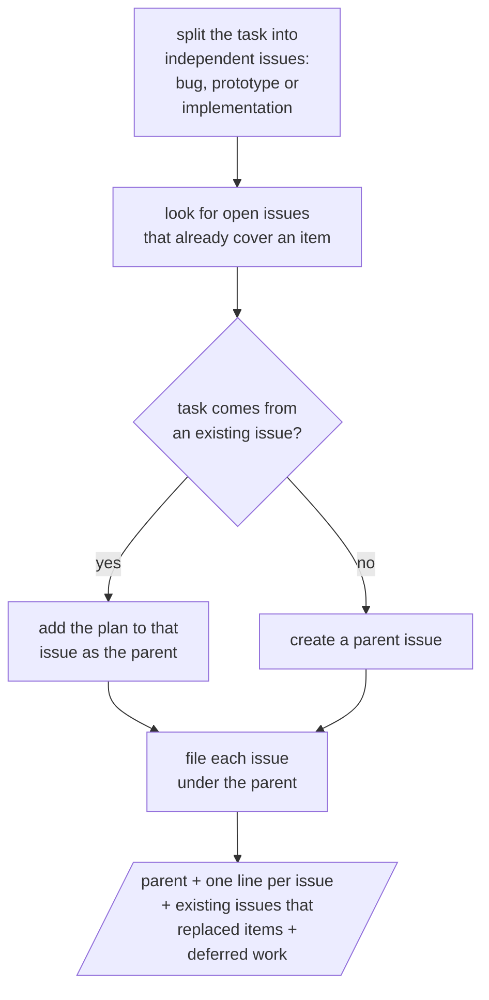

# remote-issue

Splits a task too large for one session into independent issues under one parent issue, so the issue worker implements them in parallel.

Parallelograms are what the user sees and answers.

