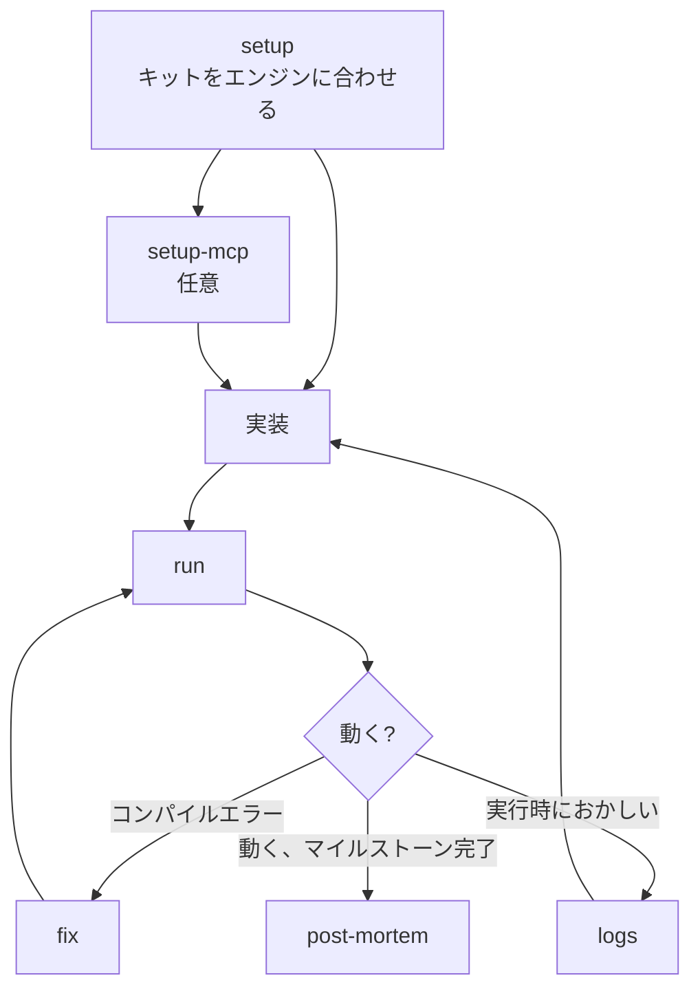

# game

ゲーム開発のためのスキル。エンジンは問わない（Unity、Godot、Unreal、自作）。ゲームをビルド・実行・修正し、マイルストーンをふりかえる。
`skill-kit game sync` のあと `init`、次に `setup` を実行して使い始める。

## 流れ

## ファイルの置き場所

| もの | 場所 |
|---|---|
| ポストモーテム | `docs/design/post-mortems/` |

## 1. セットアップ

`setup` はリポジトリごとに1回実行する。ほかのスキルはすべて、ここで記録したエンジンの情報を使う。

| スキル | すること |
|---|---|
| [setup](skills/setup/README.ja.md) | エンジンのソースフォルダ、ログ、エラー形式、ビルドと実行のコマンドを記録する |
| [setup-mcp](skills/setup-mcp/README.ja.md) | Computer Useでエディタを直接操作できるようにするか、エンジン操作サーバーをつなぎ、ログを読む代わりに動いているエンジンを操作する |

## 2. ビルド・実行・修正

| スキル | すること |
|---|---|
| [run](skills/run/README.ja.md) | ゲームをビルドして実行し、変更が動くのを確かめる |
| [fix](skills/fix/README.ja.md) | プロジェクト自身のコードのコンパイルエラーと警告を直す |
| [logs](skills/logs/README.ja.md) | 実行時のログを読む: 出力、例外、スタックトレース |

## 3. 作業をマージまで運ぶ

| スキル | すること |
|---|---|
| [cap](../../shared/skills/cap/README.ja.md) | すべてをコミットして今のブランチにpushする |
| [pr](../../shared/skills/pr/README.ja.md) | Pull Requestを作る。ブランチにすでにあれば更新する |
| [fix-pr](../../shared/skills/fix-pr/README.ja.md) | レビューの指摘、CIの失敗、コンフリクトを直し、指摘ごとに返信する |
| [delegate](../../shared/skills/delegate/README.ja.md) | 1セッションに収まらない作業を、Issueワーカーが並行して実装するIssueに分ける |
| [unblock](../../shared/skills/unblock/README.ja.md) | 待ち先が片付いた待ちのIssueにラベルを付け、Issueワーカーに着手させる |
| [automation](../../shared/skills/automation/README.ja.md) | 組織の共通GitHub Actionsと設定を入れる |

## 4. ふりかえり

| スキル | すること |
|---|---|
| [post-mortem](skills/post-mortem/README.ja.md) | マイルストーンで計画したこと、起きたこと、そこから得た教訓 |

## 設定

物語のあるゲームなら、[character](../../shared/skills/character/README.ja.md)、
[world](../../shared/skills/world/README.ja.md)、[item](../../shared/skills/item/README.ja.md)、
[outline](../../shared/skills/outline/README.ja.md) もここで使える。
