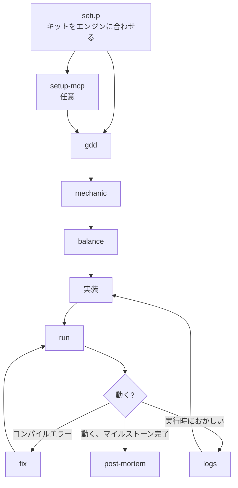

# game

ゲーム開発のためのスキル。エンジンは問わない（Unity、Godot、Unreal、自作）。設計書を書き、ゲームをビルド・実行・修正する。
`skill-kit game sync` のあと `init`、次に `setup` を実行して使い始める。

## 流れ

## ファイルの置き場所

| もの | 場所 |
|---|---|
| ゲームデザイン文書 | `docs/design/gdd.md` |
| メカニクス | `docs/design/mechanics/<slug>.md` |
| バランス | `docs/design/balance/<slug>.md` |
| ポストモーテム | `docs/design/post-mortems/` |

## 1. セットアップ

`setup` はリポジトリごとに1回実行する。ほかのスキルはすべて、ここで記録したエンジンの情報を使う。

| スキル | すること |
|---|---|
| [setup](skills/setup/README.ja.md) | エンジンのソースフォルダ、ログ、エラー形式、ビルドと実行のコマンドを記録する |
| [setup-mcp](skills/setup-mcp/README.ja.md) | エンジン操作サーバーをつなぎ、ログを読む代わりに動いているエンジンを直接操作する |

## 2. 設計

| スキル | すること |
|---|---|
| [gdd](skills/gdd/README.ja.md) | ゲームが何で、どう動くかの全体像を作る・直す |
| [mechanic](skills/mechanic/README.ja.md) | 1つのメカニクスを、実装とバランス調整ができる細かさで設計する |
| [balance](skills/balance/README.ja.md) | システムの調整できる数値、カーブ、その根拠を設計する |

## 3. ビルド・実行・修正

| スキル | すること |
|---|---|
| [run](skills/run/README.ja.md) | ゲームをビルドして実行し、変更が動くのを確かめる |
| [fix](skills/fix/README.ja.md) | プロジェクト自身のコードのコンパイルエラーと警告を直す |
| [logs](skills/logs/README.ja.md) | 実行時のログを読む: 出力、例外、スタックトレース |

## 4. ふりかえり

| スキル | すること |
|---|---|
| [post-mortem](skills/post-mortem/README.ja.md) | マイルストーンで計画したこと、起きたこと、そこから得た教訓 |

## 設定

物語のあるゲームなら、[character](../../shared/skills/character/README.ja.md)、
[world](../../shared/skills/world/README.ja.md)、[item](../../shared/skills/item/README.ja.md)、
[timeline](../../shared/skills/timeline/README.ja.md) もここで使える。
