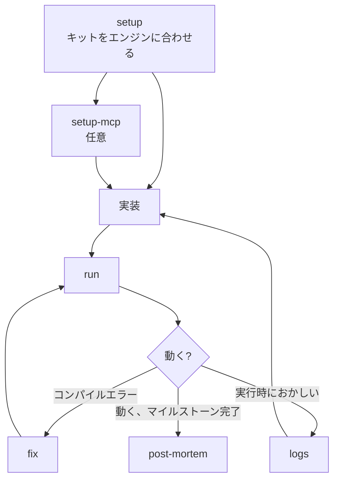

# game

ゲーム開発のためのスキル。エンジンは問わない（Unity、Godot、Unreal、自作）。ゲームをビルド・実行・修正し、マイルストーンをふりかえる。
`skill-kit game sync` のあと `init`、次に `setup` を実行して使い始める。

## 流れ

## 1. セットアップ

- [setup](skills/setup/README.ja.md)
- [setup-mcp](skills/setup-mcp/README.ja.md)

## 2. ビルド・実行・修正

- [run](skills/run/README.ja.md)
- [fix](skills/fix/README.ja.md)
- [logs](skills/logs/README.ja.md)

## 3. 作業をマージまで運ぶ

- [cap](../../shared/skills/cap/README.ja.md)
- [pr](../../shared/skills/pr/README.ja.md)
- [fix-pr](../../shared/skills/fix-pr/README.ja.md)
- [fix-prs](../../shared/skills/fix-prs/README.ja.md)
- [delegate](../../shared/skills/delegate/README.ja.md)
- [unblock](../../shared/skills/unblock/README.ja.md)
- [automation](../../shared/skills/automation/README.ja.md)

## 4. ふりかえり

- [post-mortem](skills/post-mortem/README.ja.md)

## 設定

物語のあるゲームなら、[character](../../shared/skills/character/README.ja.md)、
[world](../../shared/skills/world/README.ja.md)、[item](../../shared/skills/item/README.ja.md)、
[outline](../../shared/skills/outline/README.ja.md) もここで使える。
