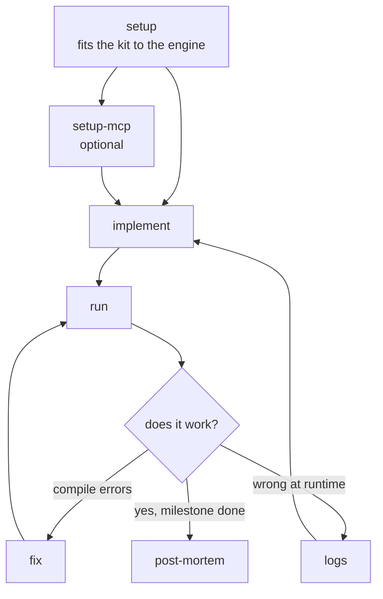

# game

Skills for game development on any engine (Unity, Godot, Unreal, custom): building, running and fixing
the game, and looking back on a milestone.
Set a repo up with `skill-kit game sync`, run `init`, then `setup`.

## Flow

## 1. Setup

- [setup](skills/setup/README.md)
- [setup-mcp](skills/setup-mcp/README.md)

## 2. Build, run and fix

- [run](skills/run/README.md)
- [fix](skills/fix/README.md)
- [logs](skills/logs/README.md)

## 3. Getting work merged

- [cap](../../shared/skills/cap/README.md)
- [pr](../../shared/skills/pr/README.md)
- [fix-pr](../../shared/skills/fix-pr/README.md)
- [delegate](../../shared/skills/delegate/README.md)
- [unblock](../../shared/skills/unblock/README.md)
- [automation](../../shared/skills/automation/README.md)

## 4. Looking back

- [post-mortem](skills/post-mortem/README.md)

## Settings

For a game with a story, [character](../../shared/skills/character/README.md),
[world](../../shared/skills/world/README.md), [item](../../shared/skills/item/README.md) and
[outline](../../shared/skills/outline/README.md) work here too.
