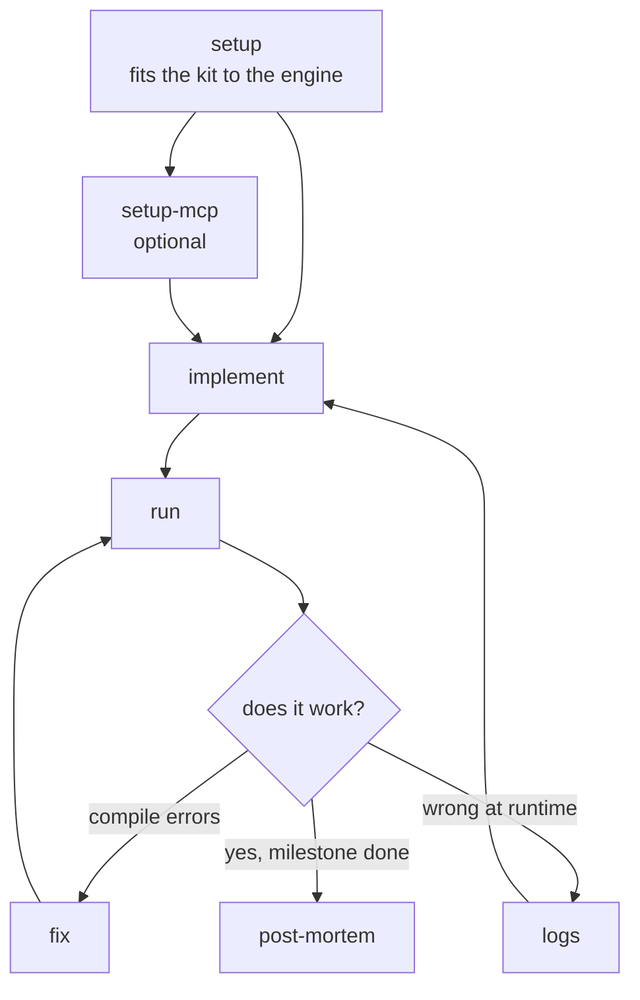

# game

Skills for game development on any engine (Unity, Godot, Unreal, custom): building, running and fixing
the game, and looking back on a milestone.
Set a repo up with `skill-kit game sync`, run `init`, then `setup`.

## Flow

## Where the files go

| What | Where |
|---|---|
| Post-mortems | `docs/design/post-mortems/` |

## 1. Setup

Run `setup` once per repo. Every other skill uses the engine facts it records.

| Skill | What it does |
|---|---|
| [setup](skills/setup/README.md) | Records the engine's source folders, logs, error formats, and build and run commands |
| [setup-mcp](skills/setup-mcp/README.md) | Lets the agent work in the engine's editor through Computer Use, or connects an engine-control server, so the kit drives the live engine instead of reading its logs |

## 2. Build, run and fix

| Skill | What it does |
|---|---|
| [run](skills/run/README.md) | Builds and runs the game, so a change can be seen working |
| [fix](skills/fix/README.md) | Fixes the compile errors and warnings in the project's own code |
| [logs](skills/logs/README.md) | Reads the runtime log: output, exceptions, stack traces |

## 3. Getting work merged

| Skill | What it does |
|---|---|
| [cap](../../shared/skills/cap/README.md) | Commits everything and pushes to the current branch |
| [pr](../../shared/skills/pr/README.md) | Opens a pull request, or updates the branch's existing one |
| [fix-pr](../../shared/skills/fix-pr/README.md) | Fixes review threads, failing CI and conflicts, then answers each thread |
| [remote-issue](../../shared/skills/remote-issue/README.md) | Splits work too large for one session into issues the issue worker implements in parallel |
| [unblock](../../shared/skills/unblock/README.md) | Labels the waiting issues whose waits are done, so the issue worker starts them |
| [automation](../../shared/skills/automation/README.md) | Sets up the org's shared GitHub Actions and configs |

## 4. Looking back

| Skill | What it does |
|---|---|
| [post-mortem](skills/post-mortem/README.md) | What was planned, what happened, and the lessons for a milestone |

## Settings

For a game with a story, [character](../../shared/skills/character/README.md),
[world](../../shared/skills/world/README.md), [item](../../shared/skills/item/README.md) and
[outline](../../shared/skills/outline/README.md) work here too.
