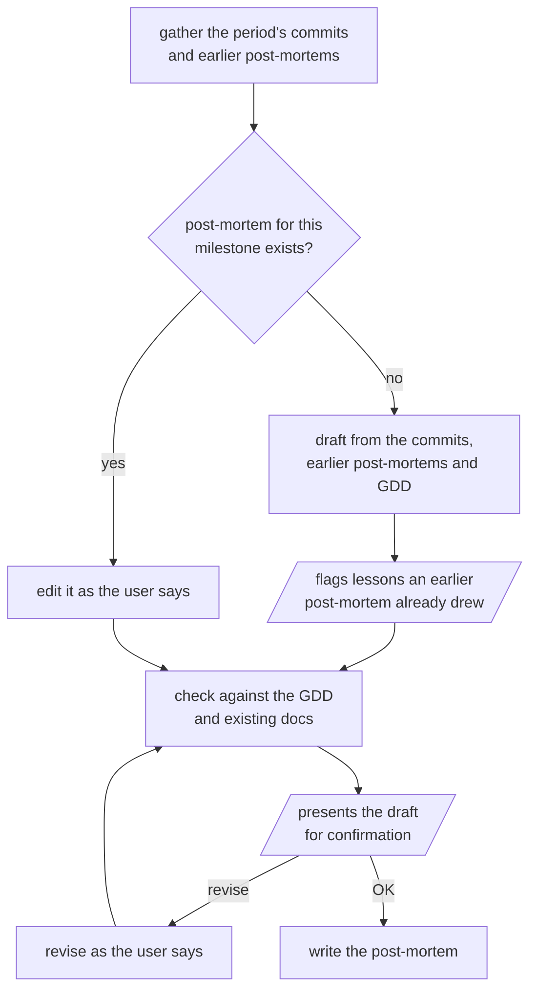

# post-mortem

Writes or edits a post-mortem for a game milestone: what was planned, what happened, what went right and wrong, and the lessons and actions that follow.

Parallelograms are what the user sees and answers.

