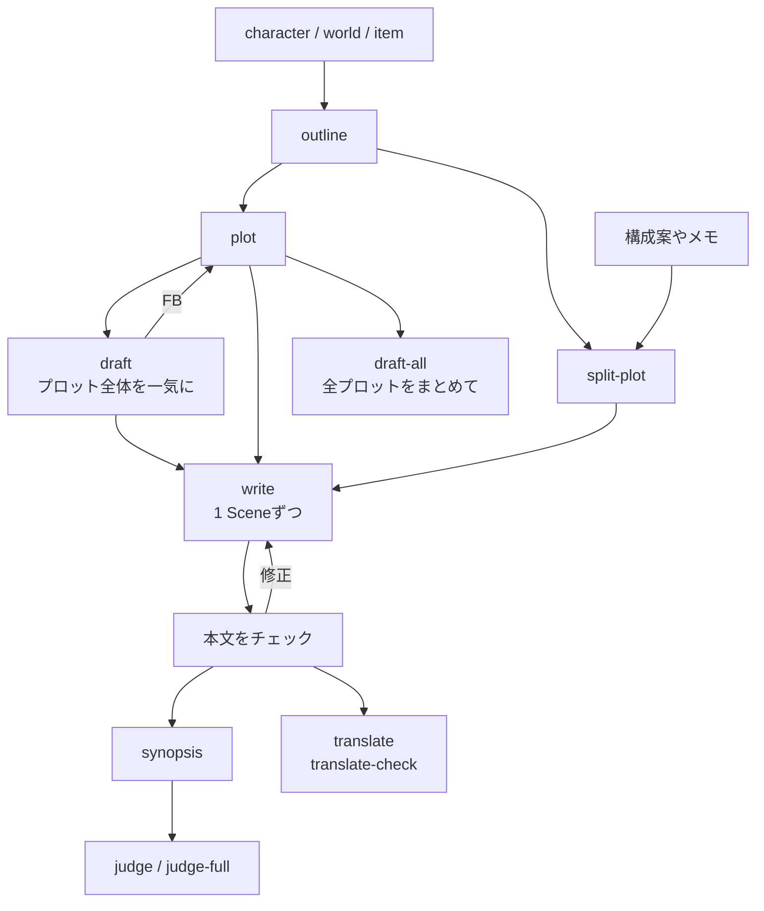

# story

小説を書くためのスキル。設定、プロット、執筆、チェック、コンテスト審査。
`skill-kit story sync` のあと `init` を実行して使い始める。

## 流れ

## 1. 設定

- [character](../../shared/skills/character/README.ja.md)
- [world](../../shared/skills/world/README.ja.md)
- [item](../../shared/skills/item/README.ja.md)

## 2. プロット

- [outline](../../shared/skills/outline/README.ja.md)
- [plot](skills/plot/README.ja.md)
- [split-plot](skills/split-plot/README.ja.md)
- [shorts-plot](skills/shorts-plot/README.ja.md)

## 3. 執筆

- [write](skills/write/README.ja.md)
- [draft](skills/draft/README.ja.md)
- [draft-all](skills/draft-all/README.ja.md)
- [load](skills/load/README.ja.md)

## 4. チェックと修正

- [check](skills/check/README.ja.md)
- [proofread](skills/proofread/README.ja.md)
- [dupcheck](skills/dupcheck/README.ja.md) / [dupcheck-all](skills/dupcheck-all/README.ja.md)
- [unnatural](skills/unnatural/README.ja.md)
- [analyze](skills/analyze/README.ja.md)
- [staging](skills/staging/README.ja.md) / [staging-all](skills/staging-all/README.ja.md)
- [format-check](skills/format-check/README.ja.md) / [format-check-all](skills/format-check-all/README.ja.md)
- [block-breaks](skills/block-breaks/README.ja.md)
- [line-break](skills/line-break/README.ja.md)
- [layman](skills/layman/README.ja.md)
- [clarify](skills/clarify/README.ja.md)

## 5. 他人の目で読む

- [read](skills/read/README.ja.md) / [read-through](skills/read-through/README.ja.md)
- [digest](skills/digest/README.ja.md) / [digest-through](skills/digest-through/README.ja.md)

## 6. 梗概とコンテスト

`judge` や `judge-full` の前に、コンテストの規定を会話で渡す。
`.agents/refs/contest-rules/` にいくつかの賞の規定がある。

- [synopsis](skills/synopsis/README.ja.md)
- [judge](skills/judge/README.ja.md)
- [judge-full](skills/judge-full/README.ja.md)

## 7. 翻訳と素材

- [translate](skills/translate/README.ja.md)
- [translate-check](skills/translate-check/README.ja.md)
- [tachie](skills/tachie/README.ja.md)
- [background](skills/background/README.ja.md)
- [bgm](skills/bgm/README.ja.md)
