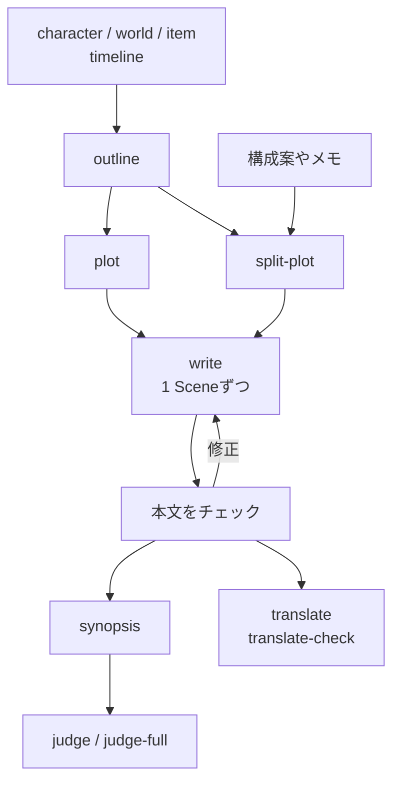

# story

小説を書くためのスキル。設定、プロット、執筆、チェック、コンテスト審査。
`skill-kit story sync` のあと `init` を実行して使い始める。

## 流れ

## ファイルの置き場所

| もの | 場所 |
|---|---|
| キャラクター | `characters/<main\|supporting\|antagonist\|archive>/<slug>.md` |
| 世界設定 | `world/` |
| アイテム | `items/` |
| 全体の流れ | `story/outline.md` |
| プロット | `story/plot/NNN-<slug>.md` |
| 本文 | `story/NNN.txt`。同じ番号のプロットファイルから書く |
| 梗概 | `story/synopsis.txt` |
| 英訳 | `story/en/` |

## 1. 設定

| スキル | すること |
|---|---|
| [character](../../shared/skills/character/README.ja.md) | キャラクターを作る・直す。名前の重複も確かめる |
| [world](../../shared/skills/world/README.ja.md) | 世界設定の要素を作る・直す |
| [item](../../shared/skills/item/README.ja.md) | アイテムを作る・直す |
| [timeline](../../shared/skills/timeline/README.ja.md) | 出来事を作中の時系列に並べて図にする |

## 2. プロット

| スキル | すること |
|---|---|
| [outline](skills/outline/README.ja.md) | プロットファイルの前に、物語全体の出来事を時系列と構成の順に整理する |
| [plot](skills/plot/README.ja.md) | 対話で大筋のプロットを作る。またはプロットファイルをチェックする |
| [split-plot](skills/split-plot/README.ja.md) | 1つの構成案やメモをシーンごとのプロットファイルに分ける |
| [shorts-plot](skills/shorts-plot/README.ja.md) | `src/shorts/` 配下の短編のプロットを作る |

## 3. 執筆

| スキル | すること |
|---|---|
| [write](skills/write/README.ja.md) | プロットファイルから本文を1 Sceneずつ書く。または本文を直す |
| [load](skills/load/README.ja.md) | ファイルを読んで、次の依頼のために覚えておく |

## 4. チェックと修正

チェックは1ファイルを取る。名前が `-all` で終わるものはディレクトリごと取る。

| スキル | 見るもの |
|---|---|
| [check](skills/check/README.ja.md) | 設定や前後のファイルとの矛盾 |
| [proofread](skills/proofread/README.ja.md) | 誤字、時制の混乱、表記ゆれ |
| [dupcheck](skills/dupcheck/README.ja.md) / [dupcheck-all](skills/dupcheck-all/README.ja.md) | 意味の重なる表現 |
| [unnatural](skills/unnatural/README.ja.md) | 地の文の不自然な日本語 |
| [analyze](skills/analyze/README.ja.md) | 文体の癖と繰り返し |
| [staging](skills/staging/README.ja.md) / [staging-all](skills/staging-all/README.ja.md) | シーンごとの描写の質 |
| [format-check](skills/format-check/README.ja.md) / [format-check-all](skills/format-check-all/README.ja.md) | Web小説の書式ルール |
| [block-breaks](skills/block-breaks/README.ja.md) | ブロックの区切りと空行 |
| [line-break](skills/line-break/README.ja.md) | 文脈の変わり目での地の文の改行 |
| [layman](skills/layman/README.ja.md) | 専門知識がないと読めない箇所 |
| [clarify](skills/clarify/README.ja.md) | その箇所を専門知識がなくても読めるように書き換える |

## 5. 他人の目で読む

| スキル | すること |
|---|---|
| [read](skills/read/README.ja.md) / [read-through](skills/read-through/README.ja.md) | 初めて読む読者としての感想 |
| [digest](skills/digest/README.ja.md) / [digest-through](skills/digest-through/README.ja.md) | 評価を入れず、本文からわかる事実だけ |

## 6. 梗概とコンテスト

`judge` や `judge-full` の前に、コンテストの規定を会話で渡す。
`.agents/refs/contest-rules/` にいくつかの賞の規定がある。

| スキル | すること |
|---|---|
| [synopsis](skills/synopsis/README.ja.md) | 梗概を書く・直す |
| [judge](skills/judge/README.ja.md) | 梗概、次に冒頭を審査する |
| [judge-full](skills/judge-full/README.ja.md) | 最終選考の審査員団が原稿全体で大賞かを決める |

## 7. 翻訳と素材

| スキル | すること |
|---|---|
| [translate](skills/translate/README.ja.md) | 日本語の本文を英訳する |
| [translate-check](skills/translate-check/README.ja.md) | 英訳を原文と双方向に照らし合わせる |
| [tachie](skills/tachie/README.ja.md) | 立ち絵の画像生成プロンプト |
| [background](skills/background/README.ja.md) | 背景の画像生成プロンプト |
| [bgm](skills/bgm/README.ja.md) | BGMのSunoプロンプト |
