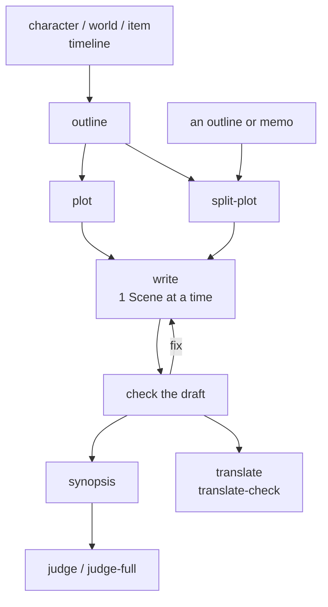

# story

Skills for writing fiction: settings, plot, drafting, checking, and contest screening.
Set a repo up with `skill-kit story sync`, then run `init`.

## Flow

## Where the files go

| What | Where |
|---|---|
| Characters | `characters/<main\|supporting\|antagonist\|archive>/<slug>.md` |
| World settings | `world/` |
| Items | `items/` |
| Whole-story flow | `story/outline.md` |
| Plot | `story/plot/NNN-<slug>.md` |
| Text | `story/NNN.txt`, written from the plot file of the same number |
| Synopsis | `story/synopsis.txt` |
| English translation | `story/en/` |

## 1. Settings

| Skill | What it does |
|---|---|
| [character](../../shared/skills/character/README.md) | Creates or edits a character, checking the name for collisions |
| [world](../../shared/skills/world/README.md) | Creates or edits a world-setting element |
| [item](../../shared/skills/item/README.md) | Creates or edits an item |
| [timeline](../../shared/skills/timeline/README.md) | Puts events in in-world order as a diagram |

## 2. Plot

| Skill | What it does |
|---|---|
| [outline](skills/outline/README.md) | Puts the whole story's events in time order and in the order the story tells them, before the plot files |
| [plot](skills/plot/README.md) | Develops the high-level plot with you, or checks a plot file |
| [split-plot](skills/split-plot/README.md) | Splits one outline or memo into a plot file per scene |
| [shorts-plot](skills/shorts-plot/README.md) | Develops the plot of a short story under `src/shorts/` |

## 3. Drafting

| Skill | What it does |
|---|---|
| [write](skills/write/README.md) | Writes the text from a plot file one Scene at a time, or revises a text file |
| [load](skills/load/README.md) | Reads files and holds them for the next request |

## 4. Checking and fixing

Each check takes one file; a skill ending in `-all` takes a whole directory.

| Skill | What it does |
|---|---|
| [check](skills/check/README.md) | Contradictions with the settings and the files before and after |
| [proofread](skills/proofread/README.md) | Typos, tense confusion, notation variance |
| [dupcheck](skills/dupcheck/README.md) / [dupcheck-all](skills/dupcheck-all/README.md) | Expressions that overlap in meaning |
| [unnatural](skills/unnatural/README.md) | Unnatural Japanese in narration |
| [analyze](skills/analyze/README.md) | Stylistic habits and repetitions |
| [staging](skills/staging/README.md) / [staging-all](skills/staging-all/README.md) | Description quality, scene by scene |
| [format-check](skills/format-check/README.md) / [format-check-all](skills/format-check-all/README.md) | Japanese web novel format rules |
| [block-breaks](skills/block-breaks/README.md) | Block breaks and blank lines |
| [line-break](skills/line-break/README.md) | Line breaks in narration where the context shifts |
| [layman](skills/layman/README.md) | Passages that need specialist knowledge |
| [clarify](skills/clarify/README.md) | Rewrites those passages for readers without it |

## 5. Reading as someone else

| Skill | What it does |
|---|---|
| [read](skills/read/README.md) / [read-through](skills/read-through/README.md) | Impressions as a first-time reader |
| [digest](skills/digest/README.md) / [digest-through](skills/digest-through/README.md) | Only the facts the text shows, with no evaluation |

## 6. Synopsis and contests

Before `judge` or `judge-full`, give the contest's rules in the conversation.
`.agents/refs/contest-rules/` has rules for several prizes.

| Skill | What it does |
|---|---|
| [synopsis](skills/synopsis/README.md) | Writes or revises the synopsis (梗概) |
| [judge](skills/judge/README.md) | Screens the synopsis, then the opening |
| [judge-full](skills/judge-full/README.md) | A panel of final-round judges decides the 大賞 on the whole manuscript |

## 7. Translation and media

| Skill | What it does |
|---|---|
| [translate](skills/translate/README.md) | Translates the Japanese text into English |
| [translate-check](skills/translate-check/README.md) | Checks the translation against the source in both directions |
| [tachie](skills/tachie/README.md) | An image prompt for a character's standing art |
| [background](skills/background/README.md) | An image prompt for a background |
| [bgm](skills/bgm/README.md) | A Suno prompt for a BGM track |
