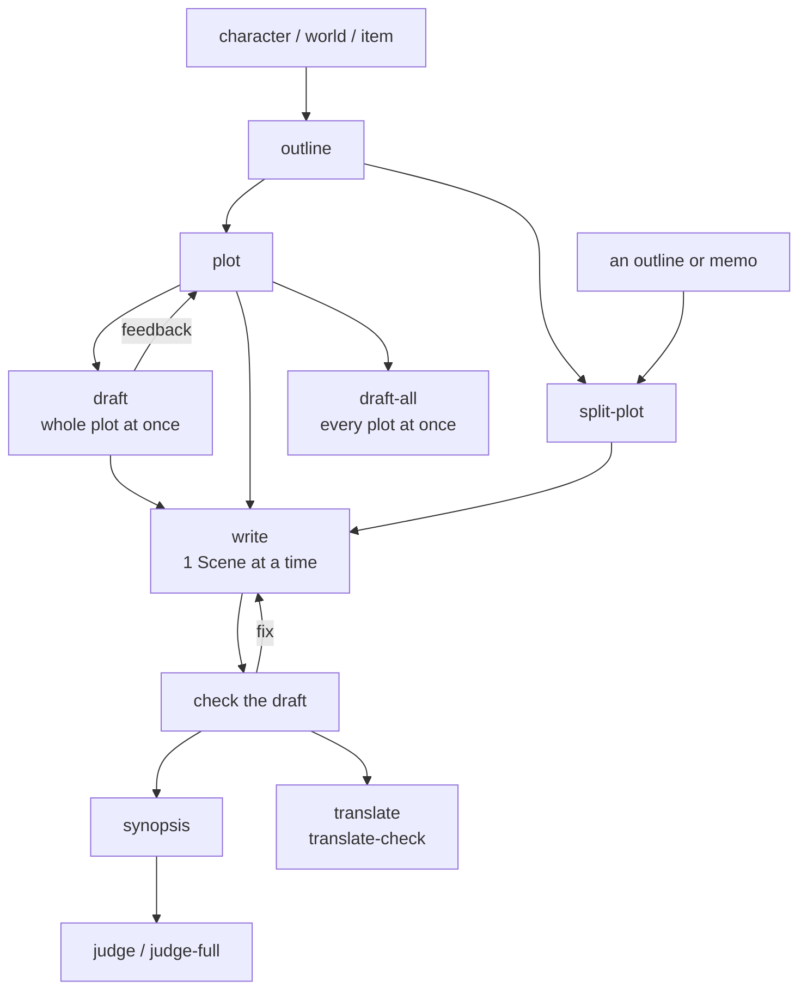

# story

Skills for writing fiction: settings, plot, drafting, checking, and contest screening.
Set a repo up with `skill-kit story sync`, then run `init`.

## Flow

## 1. Settings

- [character](../../shared/skills/character/README.md)
- [world](../../shared/skills/world/README.md)
- [item](../../shared/skills/item/README.md)

## 2. Plot

- [outline](../../shared/skills/outline/README.md)
- [plot](skills/plot/README.md)
- [split-plot](skills/split-plot/README.md)
- [shorts-plot](skills/shorts-plot/README.md)

## 3. Drafting

- [write](skills/write/README.md)
- [draft](skills/draft/README.md)
- [draft-all](skills/draft-all/README.md)
- [load](skills/load/README.md)

## 4. Checking and fixing

- [check](skills/check/README.md)
- [proofread](skills/proofread/README.md)
- [dupcheck](skills/dupcheck/README.md) / [dupcheck-all](skills/dupcheck-all/README.md)
- [unnatural](skills/unnatural/README.md)
- [analyze](skills/analyze/README.md)
- [staging](skills/staging/README.md) / [staging-all](skills/staging-all/README.md)
- [format-check](skills/format-check/README.md) / [format-check-all](skills/format-check-all/README.md)
- [block-breaks](skills/block-breaks/README.md)
- [line-break](skills/line-break/README.md)
- [layman](skills/layman/README.md)
- [clarify](skills/clarify/README.md)

## 5. Reading as someone else

- [read](skills/read/README.md) / [read-through](skills/read-through/README.md)
- [digest](skills/digest/README.md) / [digest-through](skills/digest-through/README.md)

## 6. Synopsis and contests

Before `judge` or `judge-full`, give the contest's rules in the conversation.
`.agents/refs/contest-rules/` has rules for several prizes.

- [synopsis](skills/synopsis/README.md)
- [judge](skills/judge/README.md)
- [judge-full](skills/judge-full/README.md)

## 7. Translation and media

- [translate](skills/translate/README.md)
- [translate-check](skills/translate-check/README.md)
- [tachie](skills/tachie/README.md)
- [background](skills/background/README.md)
- [bgm](skills/bgm/README.md)
