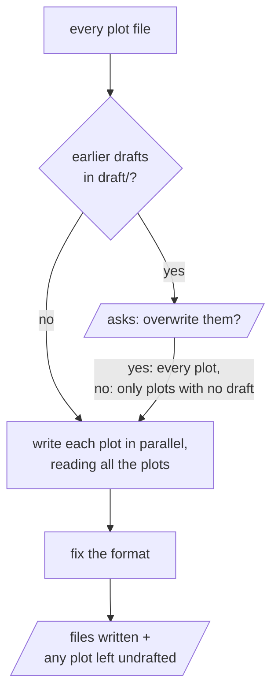

# draft-all

Writes every plot in `story/plot/` out as text in `draft/` at once. Where a plot leaves something open, the draft fills it in without asking.

Parallelograms are what the user sees and answers.

