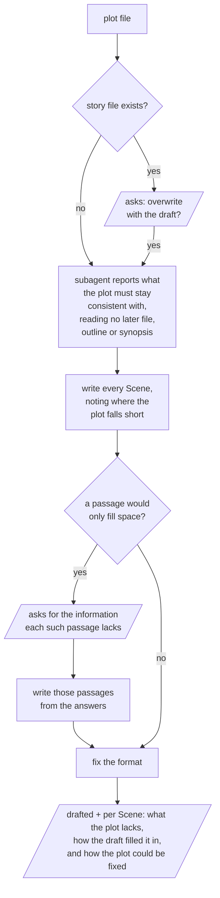

# draft

Writes a plot file out as a whole story file in one pass, then hands the plot back with
where it falls short. The plot file is left as it is.

Parallelograms are what the user sees and answers.

