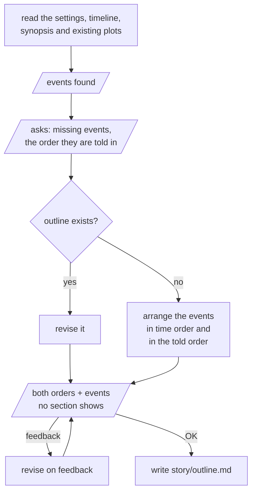

# outline

Before any plot file is made, puts the whole story's events in two orders as Markdown: the order they happen in the story world, and the order the story tells them in. Or revises the existing one.

Parallelograms are what the user sees and answers.

