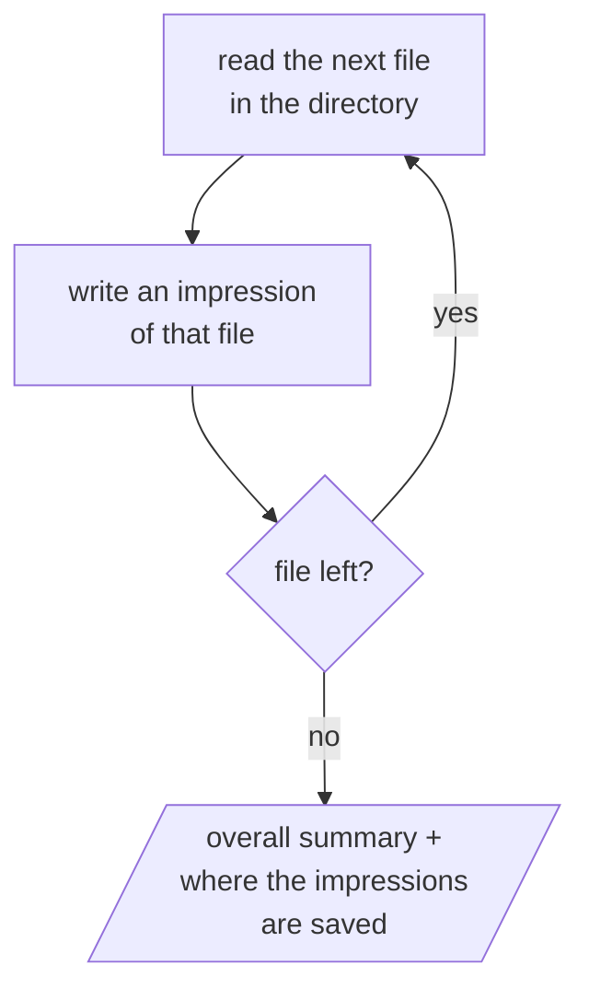

# read-through

Reads every .txt file in the given file's directory, one at a time, with an impression of each and an overall summary at the end.

Parallelograms are what the user sees and answers.

