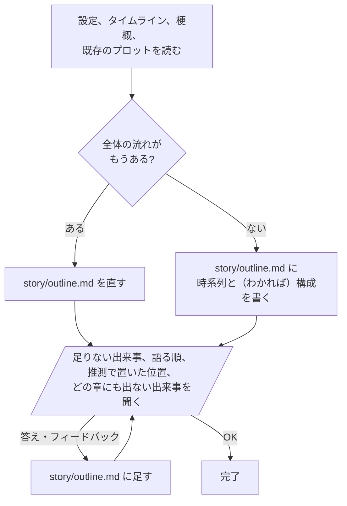

# outline

プロットファイルを作る前に、物語全体の出来事を2つの順にMermaidのフローチャートで整理する。作中で起きる順（時系列）と、物語が語る順（構成）。語る順がまだなければ時系列だけ。または既存のものを直す。

ファイルからわかる分ですぐ story/outline.md に書き、足りないものを聞いて、答えるたびにファイルへ足していく。

平行四辺形はユーザーに見えて、答えるもの。

