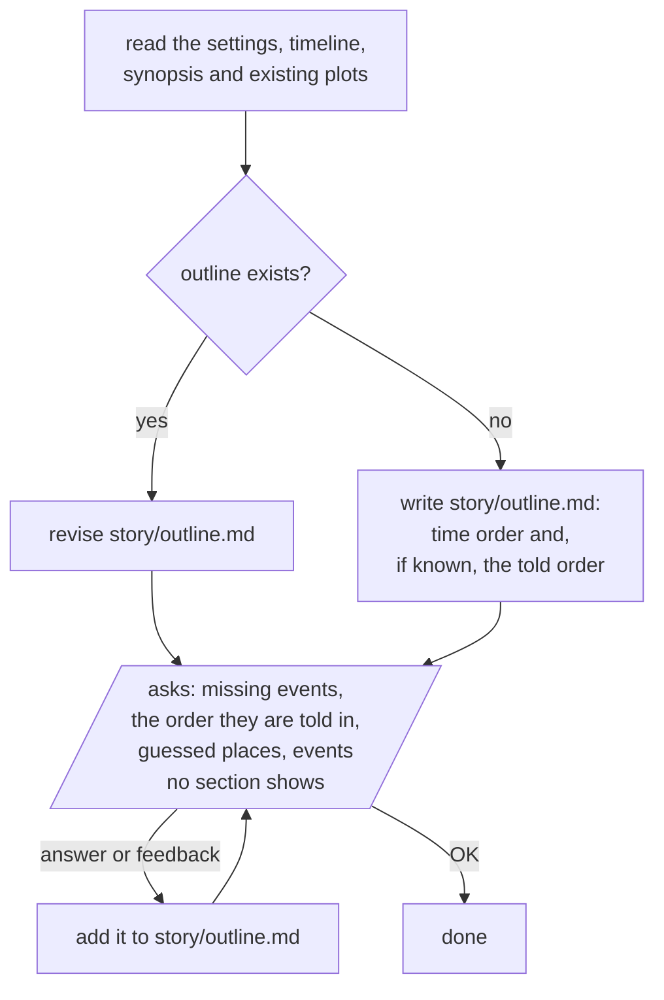

# outline

Before any plot file is made, puts the whole story's events in two orders as Mermaid flowcharts: the order they happen in the story world, and the order the story tells them in. With no told order yet, just the first. Or revises the existing one.

It writes story/outline.md right away from what the files give, then asks for what is missing and adds each answer to the file.

Parallelograms are what the user sees and answers.

